

  

<h1 align="center">ختم قرآن — Khatm Quran</h1>

  <strong>همراه روزانه‌ی شما برای برنامه‌ریزی، تلاوت و پیگیری ختم قرآن کریم</strong> 
  یک حزب در هر روز؛ از ثبت ختم و یادآوری تا تلاوت صوتی و مطالعه‌ی متن با ترجمه

  
  
  

  
  
  
  
  

---

## 📖 فهرست راهنما

- [معرفی برنامه](#-معرفی-برنامه)
- [دریافت و نصب](#-دریافت-و-نصب)
- [نگاهی سریع به محیط برنامه](#-نگاهی-سریع-به-محیط-برنامه)
- [راهنمای کامل بخش‌های برنامه](#-راهنمای-کامل-بخشهای-برنامه)
  - [۱. صفحه‌ی حزب امروز (تلاوت روزانه)](#۱-صفحه-حزب-امروز-تلاوت-روزانه)
  - [۲. ترتیل صوتی هوشمند و تنظیمات پخش](#۲-ترتیل-صوتی-هوشمند-و-تنظیمات-پخش)
  - [۳. مدیریت ختم‌ها و ثبت ختم جدید](#۳-مدیریت-ختمها-و-ثبت-ختم-جدید)
  - [۴. حزب‌های خوانده‌نشده (جبران عقب‌افتادگی)](#۴-حزبهای-خواندهنشده-جبران-عقبافتادگی)
  - [۵. تنظیمات متن، فونت و ظاهر](#۵-تنظیمات-متن-فونت-و-ظاهر)
  - [۶. یادآور روزانه و ویجت صفحه اصلی](#۶-یادآور-روزانه-و-ویجت-صفحه-اصلی)
- [پرسش‌های متداول (FAQ)](#-پرسشهای-متداول-faq)
- [حفظ حریم خصوصی و امنیت](#-حفظ-حریم-خصوصی-و-امنیت)
- [ارتباط با ما و ثبت بازخورد](#-ارتباط-با-ما-و-ثبت-بازخورد)

---

## 🌟 معرفی برنامه

خیلی از ما دوست داریم با قرآن انس دائمی داشته باشیم و آن را ختم کنیم؛ اما معمولاً فراموشی حزبِ روز و بی‌نظمی در زمان مطالعه، مانع استمرار می‌شود.

**ختم قرآن** یک برنامه‌ی ساده، خلوت و آرامش‌بخش است که به شما کمک می‌کند تلاوت قرآن را به یک عادت روزمره‌ی همیشگی تبدیل کنید. با انتخاب تاریخ شروع، برنامه هر روز یک حزب را به شما پیشنهاد می‌دهد و گام‌به‌گام تا پایان ۱۲۰ حزب قرآن همراهتان خواهد بود.

### چرا این برنامه را دوست خواهید داشت؟
* **آرامش و تمرکز:** در هر بار باز کردن برنامه، مستقیماً حزب امروز در برابرتان قرار می‌گیرد؛ بدون تبلیغات، بدون صفحات اضافی و بدون نیاز به ثبت‌نام یا اینترنت.
* **تلاوت همراه با تدبر:** اعراب‌گذاری خوانا، ترجمه روان فارسی زیر هر آیه و ترتیل دلنشین آیه‌به‌آیه.
* **همیشه در مسیر:** اگر چند روز فرصت تلاوت پیدا نکردید، برنامه حزب‌های جامانده را مرتب نگه‌می‌دارد تا بتوانید سر فرصت جبران کنید.
* **چند ختم مستقل:** می‌توانید برای خودتان، نذر یا مطالعه گروهی، چندین ختم مجزا با تاریخ‌های مختلف تعریف کنید.

---

## 📥 دریافت و نصب

| روش دریافت | توضیحات | لینک |
| :--- | :--- | :--- |
| **کافه‌بازار (پیشنهادی)** | نصب سریع و دریافت خودکار به‌روزرسانی‌ها | [صفحه برنامه در کافه‌بازار](https://cafebazaar.ir/app/ir.seyedi.khatmquran) |
| **دانلود مستقیم فایل APK** | نصب مستقیم بدون نیاز به مارکت (نسخه v1.2.2) | [دانلود فایل APK](https://github.com/seidmohsen/khatm-quran-download/releases/latest) |

> **نکته:** این اپلیکیشن روی همه‌ی گوشی‌ها و تبلت‌های دارای **اندروید ۷.۰ و بالاتر** به‌خوبی اجرا می‌شود. حجم برنامه تنها حدود **۸.۷ مگابایت** است.

---

## 📱 نگاهی سریع به محیط برنامه

<table align="center">
  <tr>
    <td align="center">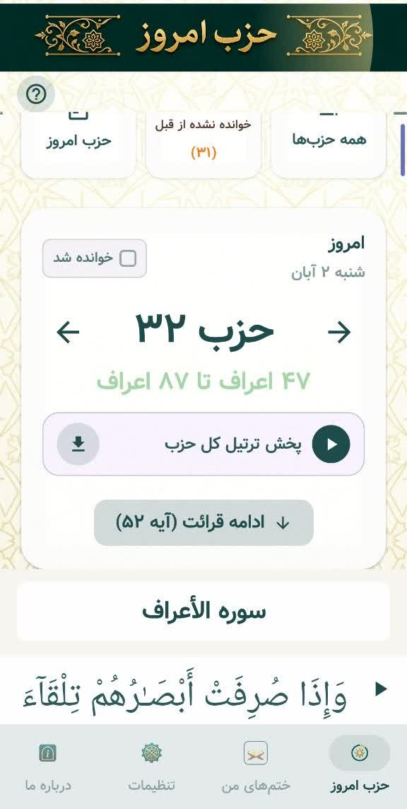 <b>حزب امروز</b> کارت حزب روز، نام سوره و شماره آیات</td>
    <td align="center">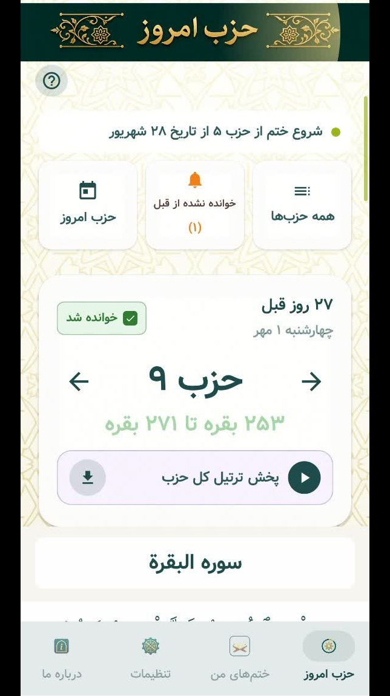 <b>پیگیری روزانه</b> علامت‌زدن حزب به‌عنوان خوانده‌شده</td>
    <td align="center">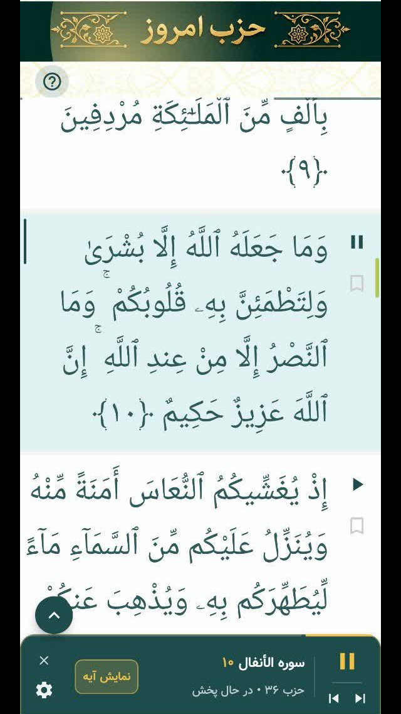 <b>ترتیل آیه‌به‌آیه</b> هایلایت آیه در حال پخش</td>
  </tr>
  <tr>
    <td align="center">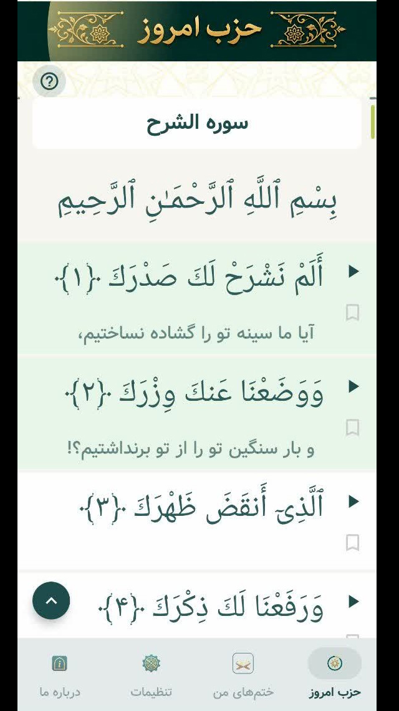 <b>متن و ترجمه</b> اعراب کامل و ترجمه فارسی</td>
    <td align="center">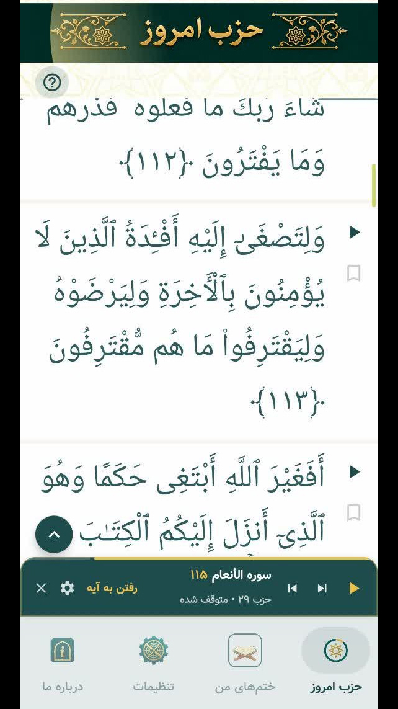 <b>پخش‌کننده صوت</b> پخش حزب و نمایش آیه جاری</td>
    <td align="center">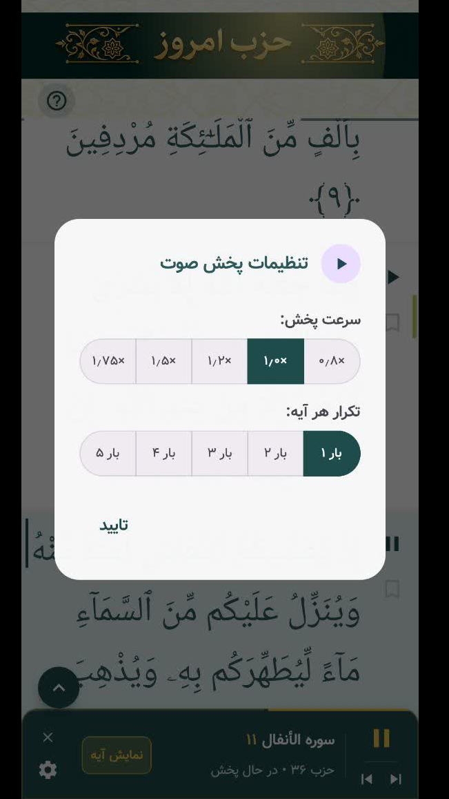 <b>تنظیمات پخش</b> سرعت پخش، تکرار و دانلود</td>
  </tr>
  <tr>
    <td align="center">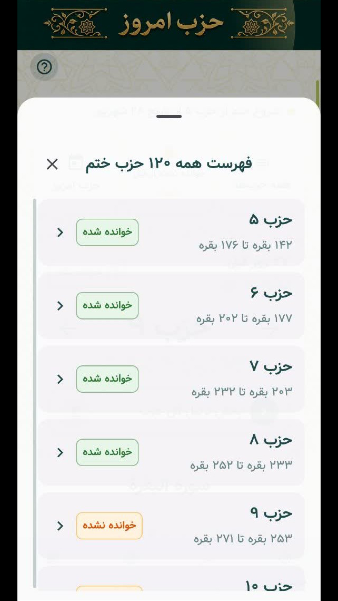 <b>فهرست ۱۲۰ حزب</b> جست‌وجو و وضعیت هر حزب</td>
    <td align="center">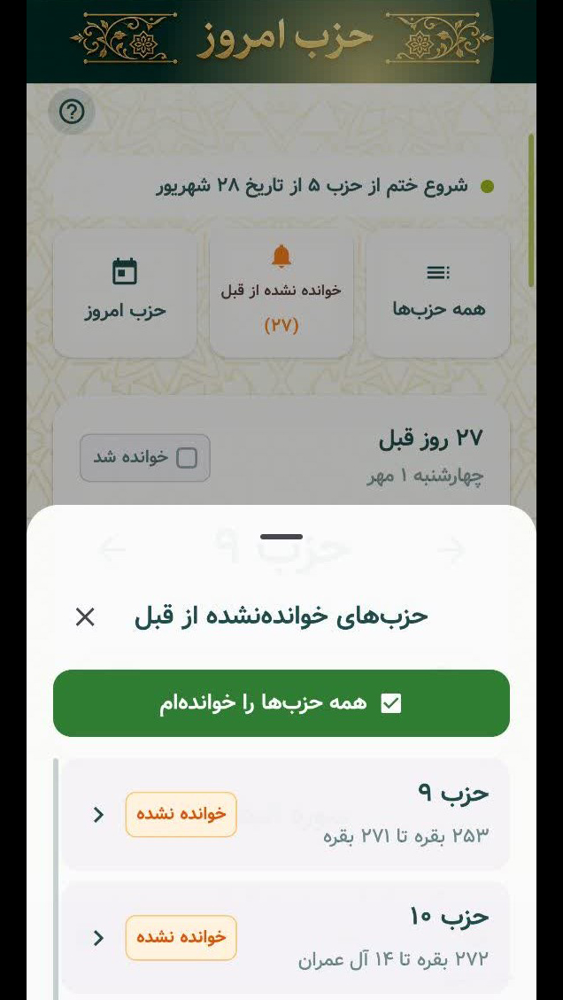 <b>حزب‌های عقب‌افتاده</b> علامت‌گذاری گروهی و پرش به آیه</td>
    <td align="center">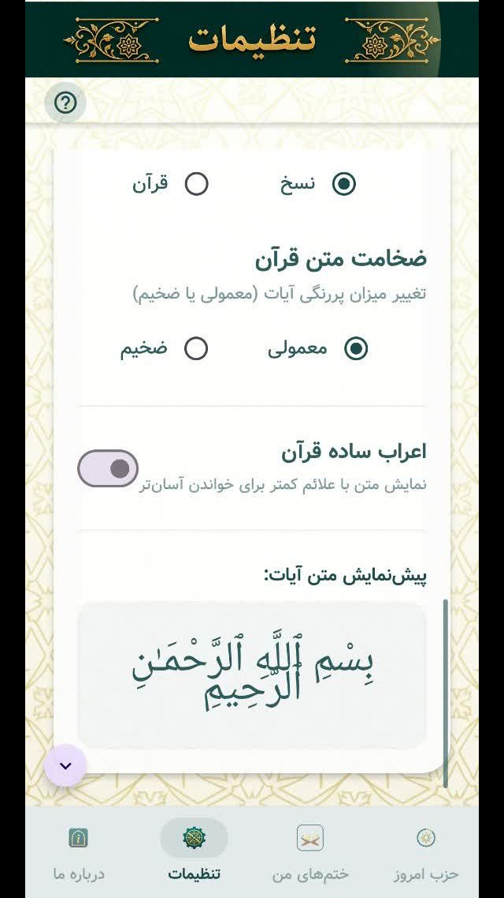 <b>تنظیمات متن</b> فونت قرآنی، اندازه و اعراب ساده</td>
  </tr>
  <tr>
    <td align="center">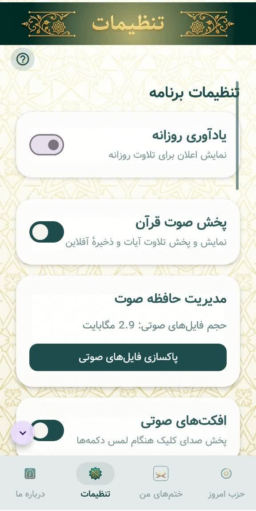 <b>یادآور و صدا</b> یادآور روزانه و مدیریت حافظه</td>
    <td align="center">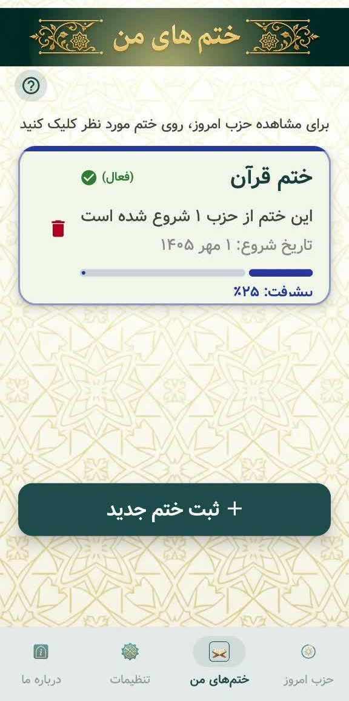 <b>ختم‌های من</b> چند ختم هم‌زمان و درصد پیشرفت</td>
    <td align="center">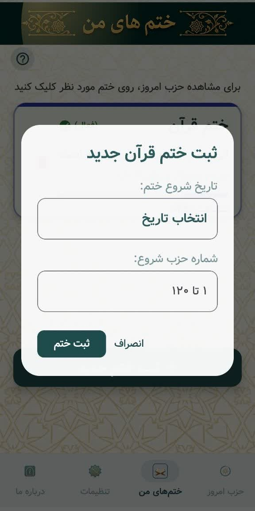 <b>ثبت ختم جدید</b> تاریخ شروع شمسی و حزب آغازین</td>
  </tr>
  <tr>
    <td align="center" colspan="3">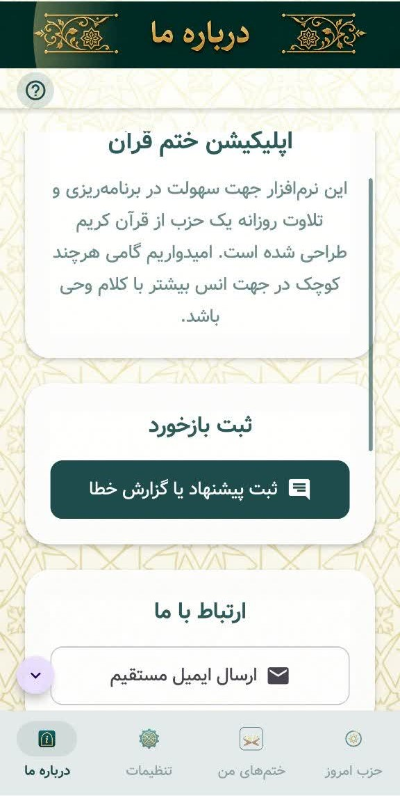 <b>درباره ما</b> تیم توسعه، بازخورد و نسخه برنامه</td>
  </tr>
</table>

---

## 🛠️ راهنمای کامل بخش‌های برنامه

### ۱. صفحه‌ی حزب امروز (تلاوت روزانه)

صفحه اصلی برنامه، حزب مخصوص همان روز را برایتان نمایش می‌دهد:

  

* **حرکت بین روزها:** با کشیدن صفحه به چپ یا راست، می‌توانید حزب روزهای قبل یا بعد را مرور کنید.
* **بزرگ‌نمایی با دو انگشت (Pinch to Zoom):** بدون نیاز به رفتن به بخش تنظیمات، با دو انگشت روی متن اندازه فونت را بزرگ یا کوچک کنید.
* **علامت «خوانده شد»:** پس از اتمام قرائت، دکمه‌ی تیک سبز را بزنید تا برنامه پیشرفت شما را ثبت کند.
* **نشانک (Bookmark):** اگر وسط مطالعه کار پیش آمد، آیکون بوکمارک همان آیه را لمس کنید تا دفعه بعد مستقیماً از همان آیه شروع کنید.
* **نمایش یا پنهان‌کردن ترجمه:** با آیکون ترجمه در بالای صفحه، متن ترجمه را باز یا بسته کنید.
* **سجده‌های واجب:** آیات سجده‌دار (در حزب‌های ۸۳، ۹۶، ۱۰۶ و ۱۲۰) با علامت مشخص شده‌اند تا از ادای واجب غافل نشوید.

---

### ۲. ترتیل صوتی هوشمند و تنظیمات پخش

با زدن دکمه‌ی پخش در پایین صفحه حزب امروز، ترتیل باکیفیت و آیه‌به‌آیه آغاز می‌شود:

  

* **هماهنگی صوت و متن:** همزمان با قرائت هر آیه، آن آیه در متن با رنگ سبز مشخص می‌شود.
* **پخش در پس‌زمینه:** حتی با خاموش کردن صفحه گوشی یا خروج از برنامه، صوت ترتیل از نوار اعلان قابل شنیدن و کنترل است.
* **تکرار هر آیه (۱ تا ۵ بار):** قابلیتی عالی برای کسانی که در حال **حفظ یا تصحیح قرائت** هستند.
* **تنظیم سرعت خواندن:** تغییر سرعت ترتیل از ۰.۸ تا ۱.۷۵ برابر برای صرفه‌جویی در وقت.
* **دانلود برای استفاده آفلاین:** می‌توانید فایل صوتی حزب را یک‌بار دانلود کنید تا در سفر یا مکان‌های بدون اینترنت هم ترتیل را گوش دهید.

---

### ۳. مدیریت ختم‌ها و ثبت ختم جدید

در تب **«ختم‌های من»** کنترل کامل برنامه‌های تلاوت را در دست دارید:

<table align="center">
  <tr>
    <td align="center"></td>
    <td align="center"></td>
  </tr>
</table>

* **ثبت ختم جدید:** روی دکمه‌ی `+` ضربه بزنید. عنوان ختم را بنویسید (مثلاً «ختم شخصی»، «نذر ماه رمضان» یا «تلاوت خانوادگی»)، تاریخ شروع را از روی تقویم شمسی انتخاب کنید و حزب آغازین را مشخص نمایید.
* **چند ختم هم‌زمان:** می‌توانید همزمان چند ختم با روزهای شروع متفاوت داشته باشید و بین آن‌ها جابه‌جا شوید.
* **درصد پیشرفت:** برای هر ختم، یک نوار پیشرفت و درصد تلاوت به شما نشان می‌دهد چقدر تا پایان مسیر مانده است.
* **آرشیو ختم‌ها:** پس از پایان ۱۲۰ حزب، ختم به‌صورت خودکار تکمیل و به بخش آرشیو منتقل می‌شود تا تاریخچه‌اش محفوظ بماند.

---

### ۴. حزب‌های خوانده‌نشده (جبران عقب‌افتادگی)

اگر مشغله کاری باعث شد چند روز تلاوت نکنید، اصلاً نگران نباشید:

  

* در این بخش، تمام حزب‌هایی که از تاریخ شروع ختم تا دیروز خوانده نشده‌اند فهرست شده‌اند.
* با لمس هر حزب، مستقیماً به ابتدای آیات آن هدایت می‌شوید تا تلاوتش کنید.
* امکان علامت‌زدن سریع یا گروهی حزب‌ها به‌عنوان «خوانده شد» نیز پیش‌بینی شده است.

---

### ۵. تنظیمات متن، فونت و ظاهر

صفحه قرآن باید باب میل و راحتی چشمان شما باشد:

  

* **قلم‌های استاندارد قرآنی:** انتخاب بین خط زیبای نسخ و فونت خوانای قرآنی (عثمان‌طه).
* **اندازه و ضخامت متن:** تنظیم اندازه نوشته‌ها از کوچک تا بسیار درشت برای مطالعه‌ی راحت سالمندان.
* **اعراب ساده:** گزینه‌ای برای ساده‌تر خواندن اعراب و حرکات دشوار قرآنی.
* **حالت شب (تم تیره):** برای تلاوت بدون خستگی چشم در فضاهای کم‌نور و پیش از خواب.

---

### ۶. یادآور روزانه و ویجت صفحه اصلی

برای اینکه تلاوت روزانه به فراموشی سپرده نشود:

  

* **هشدار یادآوری:** ساعت دلخواه خود را تنظیم کنید (مثلاً بعد از نماز صبح یا شب‌ها) تا با پیامی آرامش‌بخش یادآوری شوید.
* **ویجت صفحه اصلی (Home Screen Widget):** می‌توانید ویجت برنامه را به صفحه‌ی اصلی گوشی اضافه کنید تا بدون باز کردن برنامه، حزب امروز و سوره آن را جلوی چشمانتان داشته باشید.

---

## ❓ پرسش‌های متداول (FAQ)

  
<b>آیا برای خواندن متن قرآن به اینترنت نیاز است؟</b>

  خیر؛ متن کامل قرآن کریم به همراه ترجمه فارسی درون خود نرم‌افزار قرار دارد و ۱۰۰٪ آفلاین و بدون اینترنت کار می‌کند. اینترنت تنها در صورت شنیدن آنلاین صوت ترتیل یا ارسال پیام به ما استفاده می‌شود.

  
<b>چرا حزب امروز در لیست «حزب‌های خوانده‌نشده» نیست؟</b>

  طراحی برنامه به گونه‌ای است که حزب همان روز تا پایان شب برای شما مهلت تلاوت دارد. بنابراین تنها در صورتی که روز به پایان برسد و تیک خوانده‌شد را نزنید، از فردا وارد بخش عقب‌افتاده‌ها می‌شود.

  
<b>آیا فایل‌های صوتی دانلودشده حافظه‌ی زیادی می‌گیرند؟</b>

  خیر؛ برنامه مجهز به سامانه پاک‌سازی خودکار است و حداکثر ۵۰۰ مگابایت فضا مصرف می‌کند. همچنین در منوی تنظیمات می‌توانید با یک دکمه حافظه کش صوت را کاملاً پاک کنید.

  
<b>اگر گوشی من خاموش یا ری‌استارت شود، یادآور روزانه کار می‌کند؟</b>

  بله؛ یادآورها طوری برنامه‌ریزی شده‌اند که بلافاصله پس از روشن‌شدن گوشی مجدداً فعال شوند.

---

## 🔒 حفظ حریم خصوصی و امنیت

* **بدون ثبت‌نام و حساب کاربری:** شما برای استفاده از برنامه نیاز به وارد کردن هیچ شماره موبایل یا ایمیلی ندارید.
* **ذخیره ۱۰۰٪ محلی:** تاریخ شروع ختم‌ها و روند مطالعه شما فقط روی گوشی خودتان ذخیره می‌شود و به هیچ سروری ارسال نمی‌گردد.
* **بدون تبلیغات:** محیط معنوی تلاوت قرآن به هیچ عنوان آلوده به تبلیغات بنری یا پاپ‌آپ نخواهد شد.

---

## 💌 ارتباط با ما و ثبت بازخورد

نظرات، پیشنهادات و دعای خیر شما سرمایه این مسیر است:

* ✉️ **ایمیل پشتیبانی:** [barsaam@gmail.com](mailto:barsaam@gmail.com)
* 💬 **ارسال بازخورد درون‌برنامه‌ای:** از طریق بخش «درباره ما» در منوی برنامه
* 🐛 **گزارش خطا یا ایده جدید:** در بخش [Issues گیت‌هاب](https://github.com/seidmohsen/khatm-quran-download/issues)

  «الَّذِینَ آمَنُوا وَتَطْمَئِنُّ قُلُوبُهُم بِذِکْرِ اللَّهِ ۗ أَلَا بِذِکْرِ اللَّهِ تَطْمَئِنُّ الْقُلُوبُ» 
  التماس دعا 🤲

