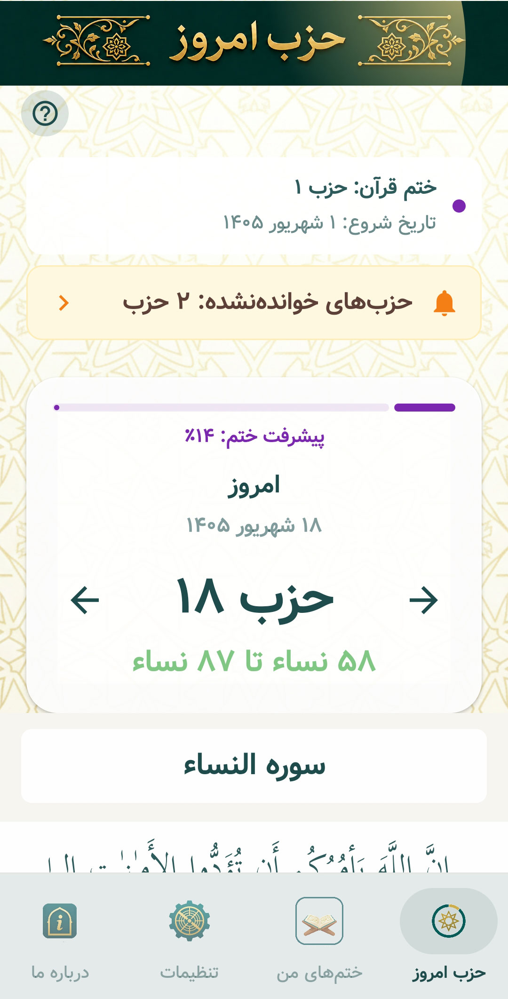
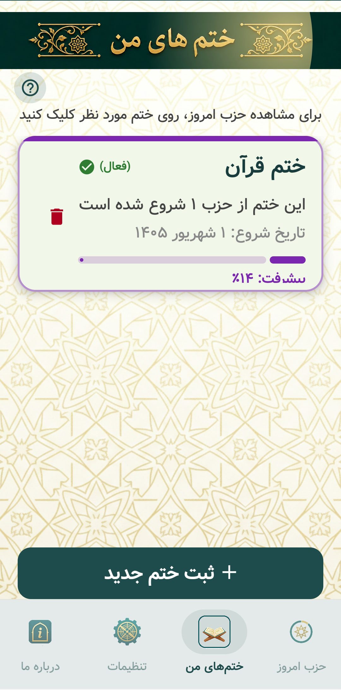
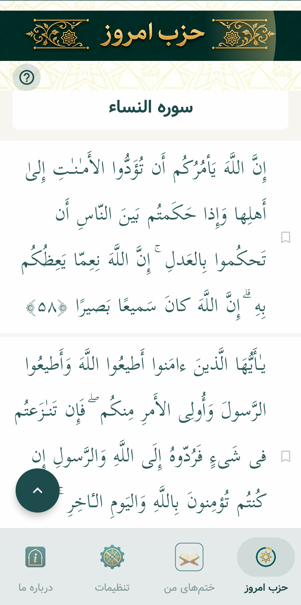
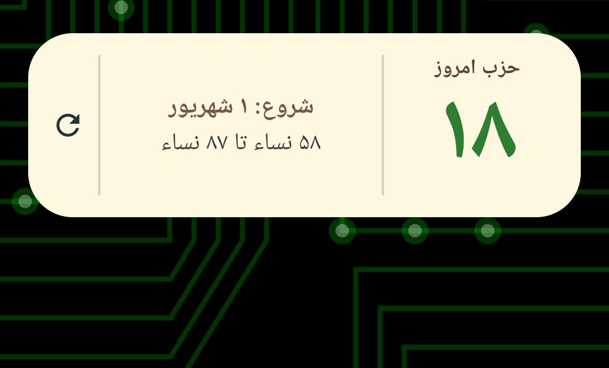

# ختم قرآن | Khatm Quran

  
  <h1>ختم قرآن | Khatm Quran</h1>
  
همراهی فارسی برای برنامه‌ریزی ختم، مطالعه روزانه و پیگیری مسیر تلاوت قرآن

  

    <a href="https://github.com/seidmohsen/khatm-quran-download/releases/latest"><strong>دریافت آخرین نسخه</strong></a>
    ·
    <a href="https://github.com/seidmohsen/khatm-quran">مخزن کد</a>
    ·
    <a href="https://github.com/seidmohsen/khatm-quran/issues">گزارش مشکل</a>
  

  

    
    
    
    
  

## درباره برنامه

**ختم قرآن** یک اپلیکیشن اندرویدی فارسی برای مدیریت چند برنامه ختم و مطالعه منظم قرآن است. برنامه حزب روز را بر اساس تاریخ شروع و حزب آغازین محاسبه می‌کند، متن عربی را همراه ترجمه فارسی نمایش می‌دهد و ابزارهایی برای ادامه مطالعه و پیگیری ختم در اختیار کاربر می‌گذارد.

کد برنامه با Kotlin و Jetpack Compose نوشته شده است. اطلاعات ختم‌ها، نشانک‌ها و تنظیمات مطالعه روی دستگاه ذخیره می‌شوند؛ قابلیت‌هایی مانند دریافت به‌روزرسانی، ارسال بازخورد و پخش یا دریافت آفلاین صوت به اتصال اینترنت نیاز دارند.

## دریافت برنامه

فایل‌های نصب و یادداشت نسخه‌ها در مخزن جداگانهٔ [khatm-quran-download](https://github.com/seidmohsen/khatm-quran-download/releases/latest) منتشر می‌شوند. از صفحهٔ **Releases**، نسخه و فایل APK موردنظر را انتخاب کنید.

> نسخهٔ سورس این مخزن در حال حاضر `1.2.1` است. نسخهٔ منتشرشده در مخزن دانلود ممکن است با نسخهٔ در حال توسعه یکسان نباشد؛ شماره نسخه و توضیحات هر انتشار را در همان صفحه بررسی کنید.

## قابلیت‌ها

- ثبت و مدیریت چند ختم هم‌زمان، انتخاب تاریخ شمسی و حزب آغازین
- محاسبه حزب روز و میزان پیشرفت هر ختم در چرخه ۱۲۰ حزبی
- مطالعه متن قرآن به زبان عربی همراه ترجمه فارسی
- مرور حزب‌های روزهای قبل و بعد و فهرست حزب‌های گذشتهٔ خوانده‌نشده
- نشانک‌گذاری و ادامه مطالعه از محل ذخیره‌شده
- تنظیم اندازه متن، بزرگ‌نمایی با دو انگشت و حالت مطالعه تیره
- پخش آنلاین تلاوت آیه‌ها و دانلود حزب برای استفاده آفلاین
- یادآور روزانه، اعلان مطالعه و ویجت «حزب امروز»
- رابط راست‌به‌چپ و بومی‌سازی‌شده برای زبان فارسی

## تصاویر برنامه

.
| صفحه اصلی و حزب امروز | ختم‌های من |
|:---:|:---:|
|  |  |
  
| فرآن | ویجت |
|:---:|:---:|
|  |  |

## داده‌ها و حریم خصوصی

فهرست ختم‌ها و تنظیمات مطالعه به‌صورت محلی در برنامه ذخیره می‌شوند. برنامه برای بررسی نسخه‌های جدید با GitHub Releases ارتباط می‌گیرد؛ پخش و دانلود صوت از زیرساخت میزبانی صوت پروژه استفاده می‌کنند و ارسال بازخورد نیز به سرویس شبکه متصل می‌شود. در نتیجه قابلیت‌های آنلاین ممکن است داده‌هایی مانند درخواست دریافت محتوا یا متن بازخورد را به سرویس مربوطه ارسال کنند.

مجوزهای اندروید در Manifest شامل اینترنت، اعلان‌ها، زمان‌بندی یادآور و دریافت رویداد راه‌اندازی مجدد دستگاه است. پیش از انتشار عمومی، سیاست حریم خصوصی و جزئیات پردازش داده‌های سرویس‌های بیرونی باید در دسترس کاربران قرار گیرد.

## مجوز و منابع محتوا

متن عربی قرآن همراه برنامه از [پروژه Tanzil](https://tanzil.net/) دریافت شده است. اعلان درج‌شده در فایل‌های متن، مجوز [Creative Commons Attribution 3.0 (CC BY 3.0)](https://creativecommons.org/licenses/by/3.0/) را مشخص می‌کند؛ متن نباید تغییر داده شود و در بازنشر باید منبع Tanzil، پیوند آن و اعلان حق نشر حفظ شود. [شرایط استفاده و اطلاعات مجوز Tanzil](https://tanzil.net/docs/) را پیش از بازنشر بررسی کنید.